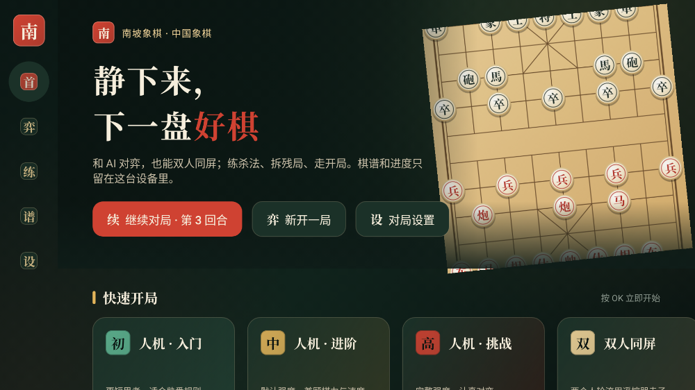
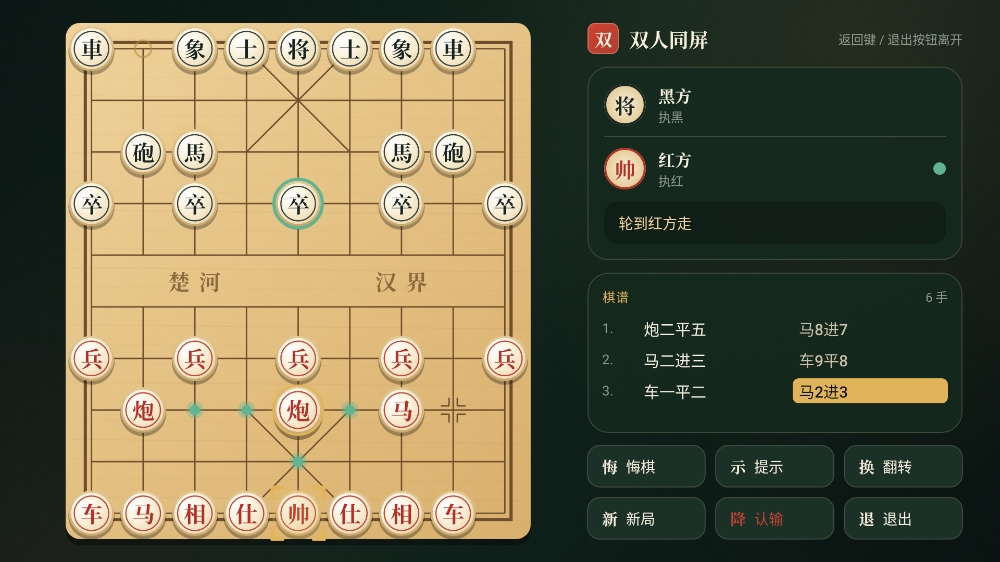
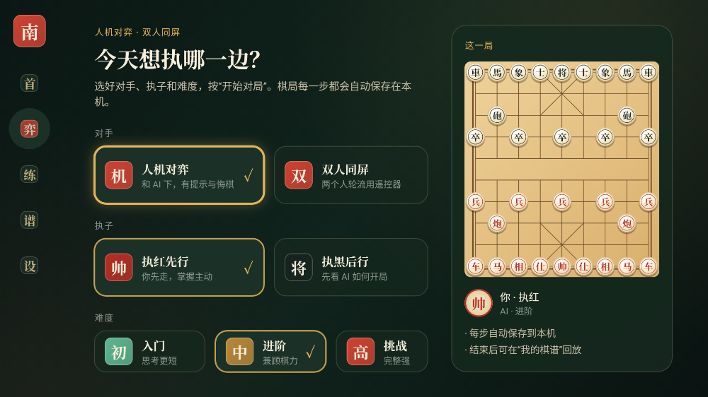
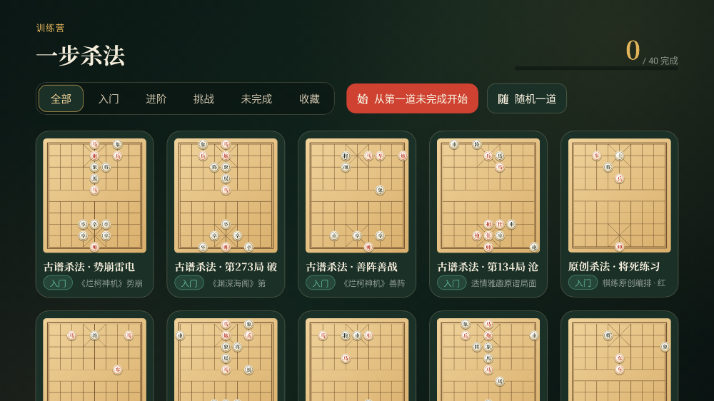
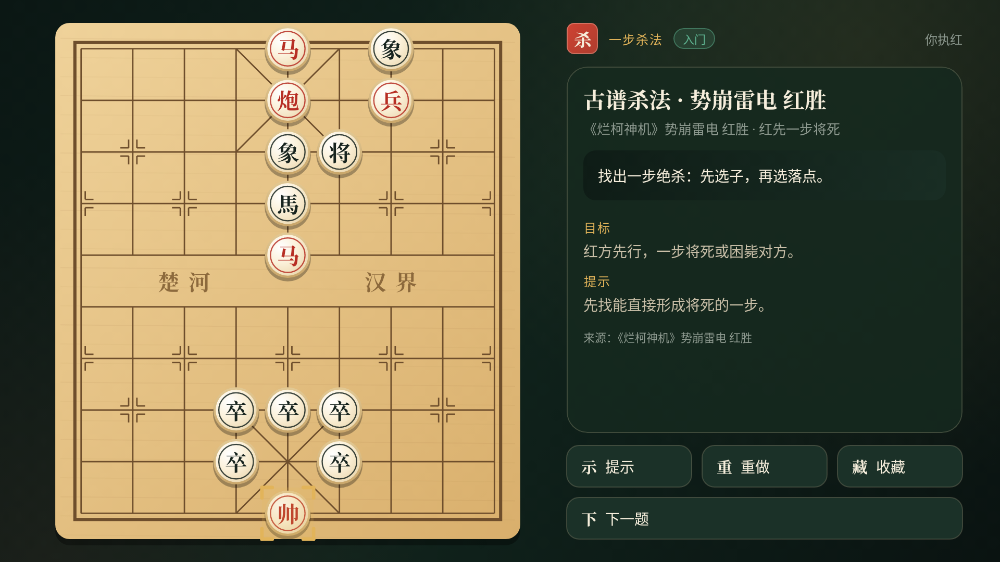
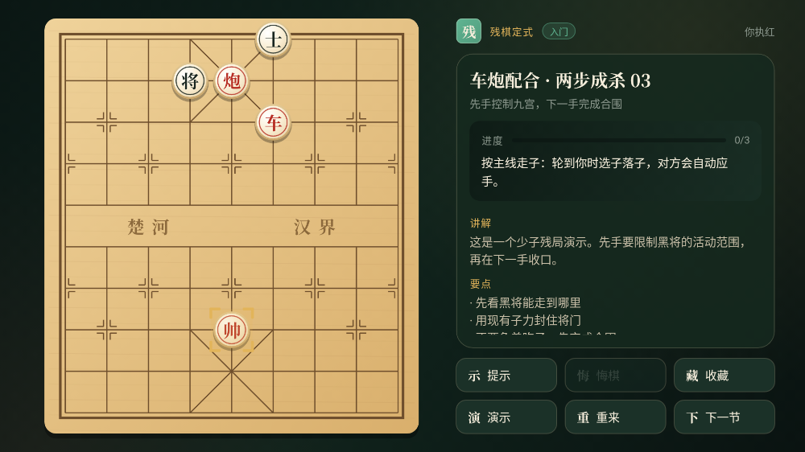
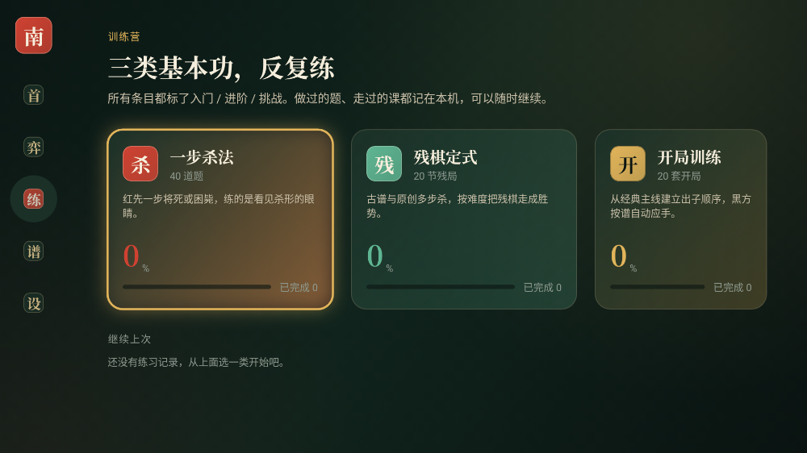

<p align="center">
  
</p>

<h1 align="center">南坡象棋</h1>

<p align="center"><b>专注中国象棋的 Android TV / 平板应用</b><br/>
人机对弈 · 双人同屏 · 杀法残局开局训练 · 棋谱回放 · 无账号、无广告</p>

<p align="center"></p>

---

## 下载安装

到本仓库 **[Releases](https://github.com/wxz52155/xiangqi/releases/latest)** 下载最新的 `NanpoXiangqi-v*.apk`（国内可在下载链接前加 `https://gh-proxy.org/` 加速）：

1. 用 U 盘、局域网传输或「当贝助手」等工具把 APK 装到电视 / 盒子 / 平板上；
2. 安装后在电视桌面（Android TV / Google TV 的应用行）或平板桌面找到「南坡象棋」；
3. 以后有新版本时应用会自动弹出更新内容，点“下载并安装”即可（也可以在 设置 → 版本 → 检查更新）；棋谱和训练进度会保留。

> 2.0.3 及更早的版本用的是临时签名，需要先卸载一次再安装新版本；2.0.4、2.0.5 的在线更新地址指向了一个没有启用的仓库，请手动安装一次 2.0.6 或更新的版本。之后都可以在应用内直接升级。

每次推送到 `main`，GitHub Actions 会自动跑测试、构建签名 APK 并发布，发布说明与应用内弹窗都会附带这次的更新记录。

## 看一眼



| 人机对弈 | 开局设置 |
| --- | --- |
|  |  |

| 一步杀法题库 | 做题 |
| --- | --- |
|  |  |

| 残棋定式跟练 | 训练营 |
| --- | --- |
|  |  |

## 能做什么

**对弈**

- **人机对弈**：执红或执黑，入门 / 进阶 / 挑战三档难度
- **双人同屏**：两个人用同一个遥控器或同一台平板轮流走子
- 悔棋、提示（棋盘上用箭头标出推荐着法）、换边、认输、新局
- 将军提示、将死与困毙判定、三次重复与六十回合不吃子判和
- 每一步自动保存，退出后首页「继续对局」接着下

**AI**

- 联网时使用在线 AI（Pikafish + NNUE），实时显示思考深度
- 断网、超时或在设置里关闭在线 AI 时，自动改用本机 AI（迭代加深 alpha-beta 搜索），离线也能下

**训练营**

| 训练 | 内容 |
| --- | ---: |
| 一步杀法 | **861** 道题 |
| 残棋定式 | **737** 节，古谱与原创多步杀法 |
| 开局 | **209** 套主线 |

- 题目卡片带棋盘缩略图，可按 入门 / 进阶 / 挑战 / 未完成 / 收藏 筛选，也可随机一道
- 杀法题：找到将死或困毙即算完成，可看提示、看答案
- 残局与开局：你走一方，对方按古谱主线自动应手，每一步有讲解；支持“演示”自动播完主线
- 完成记录、收藏、上次练到哪里都保存在本机

**棋谱**

- 自动保存每一盘，统计胜负和
- 回放时逐步前进 / 后退、自动播放，可从任意一步接着下

## 操作

| | 遥控器 | 平板触屏 |
| --- | --- | --- |
| 选择 | 方向键移动焦点，OK 确认 | 直接点 |
| 走子 | 方向键移动棋盘上的金色光标，OK 选子，再 OK 落子；光标走到边缘再按一次即移到旁边的按钮 | 点棋子，再点落点 |
| 返回 | 返回键（有选中的棋子时先取消选择）；首页连按两次退出 | 系统返回手势 / 返回键 |
| 更新 | 启动时自动检测，发现新版本弹出更新内容；设置 → 检查更新 | 同左 |
| 导航 | 在页面最左侧按左键展开导航抽屉 | 点左侧图标 |

## 技术说明

- 原生 Android 应用：Kotlin + Jetpack Compose for TV（`androidx.tv:tv-material`），Android 5.0（API 21）及以上
- 象棋规则核从网页版 TypeScript 移植到 Kotlin，用 perft 走法计数（44 / 1920 / 79666）校验与原实现一致
- 训练题库由网页版内容包导出，随 APK 打包，离线可用
- 内置裁剪过的思源宋体（Noto Serif CJK）用于标题与棋子

```text
android/
  app/                          启动 Activity、图标、电视横幅
  qilian/src/main/java/com/qilian/tv/
    xiangqi/                    规则核 Xiangqi.kt、本地 AI Engine.kt
    data/                       题库加载、本机存储、在线 AI 客户端
    game/                       对局与训练流程、音效
    ui/                         主题、组件、棋盘绘制、各页面
  qilian/src/test/              规则单元测试、界面截图测试（Paparazzi）
packages/xiangqi, packages/content   规则与训练内容（上游网页版）
apps/web                        上游网页版源码
tools/export-tv-content.ts      导出训练题库给 Android
tools/subset-tv-font.py         裁剪内置字体
```

### 本地构建

```bash
pnpm install
pnpm export:tv-content            # 导出题库到 android/app/src/main/assets/content/
cd android
./gradlew :app:assembleRelease    # 需要 JDK 17 与 Android SDK 35
```

### 自动发布、在线更新与签名

`.github/workflows/android-tv.yml`：推送 `main` → 单元测试 → 构建签名 APK → 发布 Release（版本号 `2.0.<运行编号>`）。

- **发布位置**：安装包发布到本仓库的 Releases。
- **在线更新**：每个 Release 附带 `update.json`（版本号、更新内容、安装包地址、SHA-256）。应用通过 `https://gh-proxy.org/https://github.com/wxz52155/xiangqi/releases/latest/download/update.json` 检测新版本，下载同样走 gh-proxy 加速，失败时回落直连，校验通过后调起系统安装。
- **签名**：证书在私有源码仓库的 `android/keystore/`，所有版本签名一致。**不要把源码仓库改为公开。** 也可以改用 Secrets（`ANDROID_KEYSTORE_BASE64` 等 4 项，配置后优先使用）。

更多细节见 [docs/ANDROID-TV.md](docs/ANDROID-TV.md)。

## 内容来源与许可

南坡象棋基于开源项目 **[棋练 chuccp/chess-train](https://github.com/chuccp/chess-train)**：规则核、训练题库与在线 AI 接口来自该项目，电视与平板界面为本仓库重新编写。

残棋与杀法主要整理自《适情雅趣》《橘中秘》《梅花谱》《自出洞来无敌手》《竹香斋》《百局象棋谱》等古谱。古谱原文属于公有领域，讲解由原项目重新整理，原创题目以 CC0 发布。

- 代码以 [GPL-3.0](LICENSE) 发布，第三方声明见 [SOURCE-OFFER.md](SOURCE-OFFER.md) 与 [licenses/](licenses/)
- Pikafish 代码 GPL-3.0，NNUE 权重遵循 Pikafish NNUE-License（免费、非商业）
- 本应用免费、非商业，不含广告、付费或赞助
